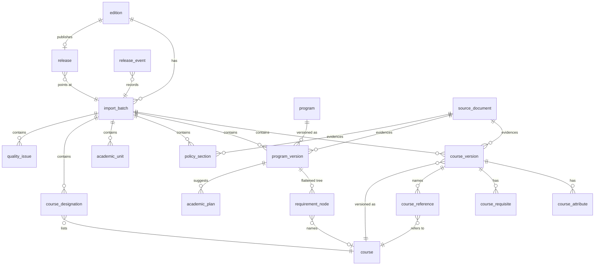

# Bulletin database and requirement language

The `bulletin` Postgres schema holds Temple's Bulletin by edition. Models live in
`apps/api/app/modules/bulletin/models.py` (own SQLAlchemy metadata), the migration
in `apps/api/alembic/versions/2026_10_24_43a9d52b7403_bulletin_schema.py`, and the
requirement language in `apps/api/app/modules/bulletin/rules.py`.

## Layers

| Concern | Tables |
| --- | --- |
| Editions, imports, publication | `edition`, `import_batch`, `release`, `release_event` |
| Raw evidence | `source_document` (URL + SHA-256 of a stored snapshot; bytes stay in the content-addressed store) |
| Stable identities | `course` (subject + number), `program` (edition-independent path) |
| Versioned facts, one batch each | `course_version`, `course_attribute`, `course_requisite`, `course_reference`, `program_version`, `requirement_node`, `academic_plan`, `academic_unit`, `policy_section`, `course_designation` |
| Quality | `quality_issue` |

## Versioning and publication

- An **import batch** is one edition's records from one run of
  `interpret`; it is written in one transaction and never edited. Its
  `fingerprint` (SHA-256 over the interpreted files and the extractor,
  interpreter and rules versions) is unique per edition, so re-importing the
  same inputs is a no-op.
- An edition's published data is the batch its `release` row points at.
  `publish` checks the gates (rows present, no `error` issues) and repoints the
  release in one short transaction; publishing an older batch is the rollback.
  Every change is appended to `release_event`.
- Readers only join through `release`, so a staged or half-written import is
  never visible.
- Foreign keys from batches and identities are `RESTRICT`. Only a batch's own
  child rows (attributes, requisites, references, nodes, plans) cascade from
  their version row. `prune` deletes a never-published batch explicitly;
  batches that were ever released stay for the history.
- Identities are deliberately thin. A course is its code; renumberings and
  equivalencies are not inferred. A program is its path within an edition
  (`/undergraduate/science-technology/computer-science-bs/`); renamed or moved
  programs appear as new identities rather than being merged by title.
- Catalog edition (`edition`), extraction time (`source_document.fetched_at`)
  and publication time (`release.published_at`) are separate columns. Effective
  dates inside policy text stay in the text until a reviewed rule states them.

## Requirement language (`rules.py`)

A program's requirements are a `RequirementTree`: one root per requirement
table, each a tree of `RequirementNode`s.

| Kind | Meaning | Key fields |
| --- | --- | --- |
| `all` | every child | |
| `any` | one child (alternatives, cross-listed codes) | |
| `choose` | a bounded selection | `min_courses`, `max_courses`, `min_credits`, `max_credits` |
| `course` | one course | `course`, `min_grade` |
| `course_filter` | courses by subject, number range, attribute, level | `course_filter` |
| `milestone` | thesis, dissertation, examination, clinical, practicum, recital… | `milestone` |
| `text` | published wording not yet expressible | `source_text`, `notes` |

Every node has a stable `id` (`t{table}.r{row}`…), `hours_text`, footnotes with
their text, `source_text`, `sources` (URL, hash, XPath, line), and two statuses:

- `interpretation`: `interpreted`, `partial` (some conditions captured; `notes`
  say what's missing) or `uninterpreted` (text only).
- `validation`: `unverified`, `structurally_checked` (rows add up to the printed
  total), `reviewed` (a person compared it with the source) or `failed` (a
  deterministic check contradicts it).

An evaluator answers each node with an `Outcome`: `satisfied`, `not_satisfied`,
`unknown` (not enough information), `not_applicable`, `requires_review` or
`unsupported`. Missing information is never `not_satisfied`, and nothing
`partial` or `uninterpreted` may evaluate to `satisfied`.

`app/modules/bulletin/evaluate.py` implements this as a pure function,
`evaluate_tree(tree, completed_courses)`, with no database or network access;
student records stay with the caller. Milestones need review, prose is
unsupported, roots that aren't `requirement` or `curriculum` don't apply, and a
course counted toward two satisfied requirements is flagged for review because
overlap rules aren't expressed yet. Over all 1,821 published program trees
(empty and random records, 3,642 evaluations in 1.4 s) no partially interpreted
node evaluated as satisfied. Optimal allocation of courses across overlapping
requirements (for example with OR-Tools CP-SAT) is a later, separate step.

Prerequisites and corequisites use `RequisiteExpression`: `all`, `any`, `choose`
(`min_count`, `min_credits`), `course` (`min_grade`, `concurrent`),
`course_filter` (with `min_count`, `min_credits` or `min_gpa`), `test` (Banner
placement/test code and score), `condition` (standing, admission and similar
named conditions) and `text`. `Requisite.courses` lists every code the passage
names even when parsing fails.

Recommended plans (`academic_plan`) are stored as printed and are advice, not
requirements; a course's semester in a plan says nothing about when it's offered.

## Queries and indexes

| BetterSSB question | Path |
| --- | --- |
| Course by code and edition | `course (subject, number)` unique → `course_version (batch_id, course_id)` unique |
| Search titles and descriptions | `course_version.search` (weighted `tsvector`, GIN) or `title % q` (`pg_trgm` GIN), ranked by `ts_rank + similarity` |
| Search by code prefix | ids from `course (subject, number)`, or-ed as a literal list |
| Filter by subject, credits, attributes, level | `course`, `credits_min/max`, `course_attribute (attribute)` index, `levels` array |
| What requires a course | `course_reference (referenced_course_id)` index |
| Programs that use a course | `requirement_node (course_id)` index |
| Majors and minors in a college | `program_version (batch_id, unit_slug)` index, `credential` |
| A program's requirement tree | `program_version.requirements` JSONB, one row |
| Compare across editions | `program_version (program_id)` / `course_version (course_id)` indexes through each edition's release |
| Source citation for any rule | `sources` on each node and record; `source_document` for the snapshot |
| Unresolved rules | `requirement_node (interpretation)` index, `quality_issue (batch_id, code)` |

Measured latencies are in `benchmark-20261024.json` (and `progress.md`); the
benchmark is `apps/api/scripts/bulletin_benchmark.py`.

## Why Postgres, relational with typed JSONB

The read workload is lookups by key, filtered lists, text search and "who
references X" joins, all served by B-tree, GIN and `pg_trgm` indexes in single-
digit milliseconds on two full editions (138 MB including indexes). Requirement
trees are stored whole as typed JSONB because they are read whole and their
shape varies by program; they are also flattened into `requirement_node` so
cross-program questions stay relational. No graph, document or search engine is
needed for these queries, and production already runs Postgres (Neon).
