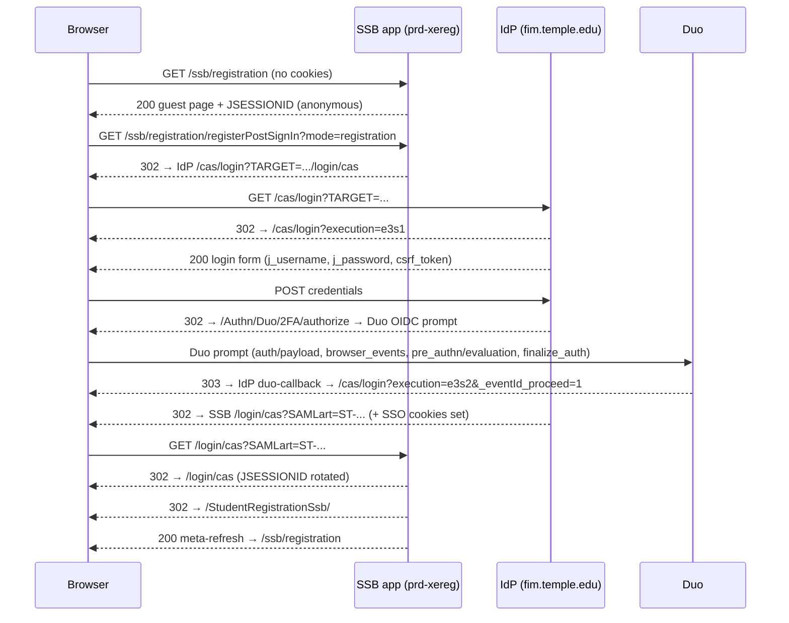

# SSB login system (reverse-engineered)

Researched November 15, 2026, from a live HAR capture of a full login, silent SSO
re-authentication, and session-loss cycle: [`data/ssb/login check.har`](../data/ssb/login%20check.har)
(286 requests, 11 page loads, 2026-11-16 02:46:21–02:47:41 UTC, Chrome WebInspector export).
Environment: Temple prd (`prd-xereg.temple.edu`), Ellucian Self-Service Banner registration,
authenticated user "Victor Jimenez-Lorenzo", student persona.

This document describes how the system decides whether a session is logged in, what
state each layer holds, how long sessions live, and how to detect/trust login state
programmatically (including from `apps/extension`).

## Contents

- [Architecture overview](#architecture-overview)
- [Full login flow](#full-login-flow)
- [How "logged in" is determined](#how-logged-in-is-determined)
- [Cookie inventory](#cookie-inventory)
- [Session lifetimes and timeouts](#session-lifetimes-and-timeouts)
- [Observed anomalies](#observed-anomalies)
- [Programmatic login-check recipes](#programmatic-login-check-recipes)
- [Chrome extension monitoring design](#chrome-extension-monitoring-design)
- [Security notes](#security-notes)
- [References](#references)

## Architecture overview

Three independent systems each hold part of the login state:

| Host | Role | Server signature |
| --- | --- | --- |
| `prd-xereg.temple.edu` | Ellucian Banner SSB app (`/StudentRegistrationSsb`). Serves pages, JSON/XML endpoints, and the CAS ticket-validation endpoint. | `volt-adc` (Akamai edge) |
| `fim.temple.edu` | SSO identity provider: CAS frontend (`/idp/profile/cas/login`) over a Shibboleth IdP. Owns the SSO session. | `Jetty(12.1.11)` |
| `api-b2781b65.duosecurity.com` | Duo OIDC second factor. Reached only between password auth and ticket issuance. | — |
| `tuportal6.temple.edu` | Static Temple branding assets (logo, favicon). | — |
| `theme.elluciancloud.com` | Ellucian theme service (`getTheme`). | — |

Edge/load-balancing in front of the app: Akamai (`TS*` session cookies) and an F5 pool
(`BIGipServerprd_xereg_8180_pool` stickiness cookie).

The three login-state layers:

1. **SSB app session** — the servlet session behind `JSESSIONID` (path-scoped to
   `/StudentRegistrationSsb`). Holds the registered persona and user context.
2. **CAS SSO session** — the Shibboleth session behind the `shib_idp_session_ss` /
   `__Host-shib_idp_session` cookies on `fim.temple.edu`. Survives across app sessions
   and allows silent re-authentication (new service tickets without credentials).
3. **Service tickets (ST)** — one-shot bearer tokens the IdP mints per login; exchanged
   at the app for layer-1 state. Never persist.

## Full login flow



Evidence (entry indices into the HAR, all times UTC 2026-11-16):

1. **Anonymous start** (02:46:21, entry 0): `GET /StudentRegistrationSsb/ssb/registration`
   with no cookies → `200` and sets an anonymous `JSESSIONID` plus Akamai `TS*` cookies.
   The landing page renders for guests (see
   [How "logged in" is determined](#how-logged-in-is-determined)).
2. **Gate** (02:46:35, entry 26):
   `GET /ssb/registration/registerPostSignIn?mode=registration` → `302` with
   `Location: https://fim.temple.edu/idp/profile/cas/login?TARGET=https%3A%2F%2Fprd-xereg.temple.edu%2FStudentRegistrationSsb%2Flogin%2Fcas`.
3. **CAS form** (entries 27–35): the IdP 302s to `?execution=e3s1` and serves an HTML
   form posting to `/idp/profile/cas/login?execution=e3s1` with fields `j_username`,
   `j_password`, and a `csrf_token` hidden input.
4. **Duo 2FA** (entries 36–54, 02:46:49–02:46:51): after the password POST the IdP
   chains `/idp/profile/Authn/Duo/2FA/authorize` → `api-b2781b65.duosecurity.com/oauth/v1/authorize`
   → the Duo prompt (`/prompt/<ACCOUNT>/oidc/v1/<APPID>/authorize`). The prompt page makes
   `GET .../auth/payload`, several `POST .../auth/browser_events` calls, then
   `GET .../pre_authn/evaluation` and `GET .../auth/finalize_auth`, and exits via
   `GET /frame/v4/oidc/external/exit?code=...&state=...` → 303 back to the IdP
   (`/idp/profile/Authn/Duo/2FA/duo-callback`, entry 58).
5. **Ticket issuance** (entry 59, 02:46:52): the IdP responds to
   `GET /cas/login?execution=e3s2&_eventId_proceed=1` with `302` →
   `https://prd-xereg.temple.edu/StudentRegistrationSsb/login/cas?SAMLart=ST-<ticket>`.
   This response **sets the two SSO cookies** on `fim.temple.edu`.
6. **Ticket exchange** (entries 60–61): `GET /login/cas?SAMLart=ST-...` → `302` →
   `GET /login/cas` → `302` → `/StudentRegistrationSsb/`. The exchange response rotates
   `JSESSIONID` (session-fixation behavior: `75152E84…` → `152C01FB…` →
   `59E46647…` → `955C0696…` across entries 60/65/66).
7. **Landing** (entries 65–66): `/StudentRegistrationSsb/` returns a 374-byte page whose
   only content is `<meta HTTP-EQUIV="REFRESH" content="0; url=ssb/registration">`.

The ST ticket travels in the query parameter named **`SAMLart`** (Ellucian's SAML-artifact
naming), not the usual CAS `ticket`. Three distinct one-shot tickets were issued in the
capture (entries 59, 91, 254), one per login/SSO round-trip.

### Silent SSO re-authentication

When the app session is gone but the SSO session is alive, the whole flow collapses to
redirects — no form, no Duo (entries 90–95, 02:47:05; and 253–258, 02:47:38):

```
GET  /ssb/registration/registerPostSignIn?mode=registration   → 302
GET  fim.temple.edu/idp/profile/cas/login?TARGET=...           → 302 (immediate, new ST)
GET  /login/cas?SAMLart=ST-...                                 → 302
GET  /login/cas                                                → 302
GET  /ssb/registration/registerPostSignIn?mode=registration&continue  → 302
GET  /ssb/term/termSelection?mode=registration&...             → 200 (authenticated)
```

The IdP recognizes the SSO cookies, mints a fresh ST, and bounces back. Note the
**second** `registerPostSignIn` call (with the `&continue` parameter) is what finally
lands on content.

## How "logged in" is determined

There is no single boolean endpoint. The app answers "are you logged in?" three
different ways, each observable:

### Layer 1 — app session (`JSESSIONID` on prd-xereg.temple.edu)

**Probe A — the gate endpoint.** `GET /StudentRegistrationSsb/ssb/registration/registerPostSignIn?mode=registration`
with the app cookies, *without following redirects*:

| State | Response |
| --- | --- |
| Logged in | `302` → app content, e.g. `/StudentRegistrationSsb/ssb/term/termSelection?mode=registration...` |
| Not logged in (or session without completed sign-in) | `302` → `https://fim.temple.edu/idp/profile/cas/login?TARGET=...` |

**Probe B — menu XML (read-only, no state change).** `GET /StudentRegistrationSsb/ssb/selfServiceMenu/data`:

| State | Body |
| --- | --- |
| Logged out | `<NavigationEntries />` (21 bytes) |
| Logged in | `<NavigationEntries>` populated with `<NavigationEntryValueObject .../>` entries (~1 KB) |

**Probe C — page markers.** Any SSB HTML page carries meta tags that differ by state:

| Marker | Logged out | Logged in |
| --- | --- | --- |
| `<meta name="fullName">` | `content=""` | `content="Victor Jimenez-Lorenzo"` |
| inline `selectedPersona:` | absent | `"Student"` |
| `<meta name="maxInactiveInterval">` | `1800` | `3600` |
| `<meta name="hasActiveActionItems">` | `content=""` | `content="false"` (set) |
| `<meta name="isUsageTrackingEnabled">` | `content=""` | `content="Y"` |
| landing tiles | reduced set ("Browse Classes(Class Schedule)") | adds "Prepare for Registration", "View Registration Information" |

Other meta tags present in both states (context, not auth): `loginEndpoint`,
`logoutEndpoint`, `guestLoginEnabled` (`false`), `guestAuthenticationEnabled`,
`requestContext` (`/StudentRegistrationSsb`), per-page `synchronizerToken` (UUID,
changes on every render).

**Not reliable as a check:**

- `GET /ssb/registration` returns `200` in both states — status code alone says nothing.
- `GET /ssb/userPreference/fetchUsageTracking` returns the same generic JSON either way
  (`isUsageTrackingEnabled: "Y"`, `isEllucianTrackerAllowed: false`, `isTrackerIdAvailable: "Y"`).
- There is **no user-info JSON endpoint** anywhere in the capture; identity exists only
  in HTML meta/inline JS.

### Layer 2 — CAS SSO (cookies on fim.temple.edu)

The IdP checks its own Shibboleth session cookies. Probe:
`GET https://fim.temple.edu/idp/profile/cas/login?TARGET=<anything>` without following
redirects:

| State | Response |
| --- | --- |
| SSO alive | `302` with `Location: .../login/cas?SAMLart=ST-<new ticket>` (silent ticket) |
| SSO dead | `302` → `?execution=e3sN`, then `200` login form (full login + Duo) |

The SSO cookies (`shib_idp_session_ss`, `__Host-shib_idp_session`) are set **only** by
the successful password+Duo response (entry 59) and are refreshed with a new value on
every SSO round-trip (entries 91, 254). Before authentication the IdP domain holds only
an anonymous `__Host-JSESSIONID` (entry 27).

### Layer 3 — ticket exchange (`/login/cas`)

`GET /StudentRegistrationSsb/login/cas?SAMLart=ST-<ticket>` consumes the one-shot ST and
binds identity to the app session. Observed behavior:

- responds `302` to `/login/cas` (which then 302s to `/StudentRegistrationSsb/`);
- **rotates `JSESSIONID`** in the exchange response (session fixation);
- the ticket is single-use — each round-trip in the capture used a distinct ST.

## Cookie inventory

Full `Set-Cookie` attributes were recovered from the HAR (values redacted here).
**Every session-bearing cookie is a session cookie — none carries `Expires`/`Max-Age`.**

| Cookie | Domain | Attributes (verbatim) | Set when | Purpose |
| --- | --- | --- | --- | --- |
| `JSESSIONID` | `prd-xereg.temple.edu` | `Path=/StudentRegistrationSsb; Secure; HttpOnly` | every app response (rotates on login and on session loss) | Spring servlet session = app login state |
| `TS0161403d` | `prd-xereg.temple.edu` | `path=/StudentRegistrationSsb; Secure; HttpOnly; SameSite=Strict` | app responses | Akamai edge session (value identical to TS01dc4fc6) |
| `TS01dc4fc6` | `prd-xereg.temple.edu` | `Path=/; Secure; HttpOnly; SameSite=Strict` | app responses | Akamai edge session |
| `BIGipServerprd_xereg_8180_pool` | `prd-xereg.temple.edu` | `path=/; Httponly; Secure` | once, during ticket exchange (entry 60) | F5 load-balancer stickiness |
| `shib_idp_session_ss` | `fim.temple.edu` | `Path=/; Secure; HttpOnly` | successful login; new value each SSO use | Shibboleth IdP secure session (SSO state) |
| `__Host-shib_idp_session` | `fim.temple.edu` | `Path=/; Secure; HttpOnly` | successful login | SSO session anchor (`__Host-` = host-only, Secure, path=/) |
| `__Host-JSESSIONID` | `fim.temple.edu` | — | anonymous IdP session | IdP servlet session, pre-auth |
| `frameless-session-binding-*` | `api-b2781b65.duosecurity.com` | `expires=+~15 min; HttpOnly; Path=/; SameSite=Lax; Secure` | Duo prompt | Duo frameless prompt session binding |
| `browsertrust\|...` | `api-b2781b65.duosecurity.com` | `expires=+30 days; HttpOnly; Path=/; SameSite=None; Secure` | Duo prompt | Duo "remember this device" trust |

Implication: **the server never tells the client any absolute deadline.** SSO lifetime is
"until the browser profile closes or the IdP invalidates server-side state"; app session
lifetime is a sliding inactivity window (next section).

## Session lifetimes and timeouts

- **App session**: inactivity-based, sliding. The only time value the server exposes is
  `<meta name="maxInactiveInterval">`: **3600 s (1 h) authenticated, 1800 s (30 min)
  guest**. Each request to the app resets the window (standard servlet
  `session.timeout` semantics). Remaining time = `lastActivity + maxInactiveInterval − now`.
- **Page-side logout timer** (what actually signs students out): every SSB page runs
  `InactivityTimer` from `assets/modules/bannerWeb-mf-*.js` (entry 8). It shows a
  "session expiring" warning `maxInactiveInterval − 90` s after the page's last jQuery
  request (`activityEvents: ["ajaxStart"]`), and 60 s later sets
  `window.location = "logout/timeout"` unless the student clicks the keep-alive button
  (which GETs `<meta name="keepAliveURL">`). So a signed-in page logs out about
  59.5 min after its last Banner request, and a guest page after about 29.5 min.
  Requests made with `fetch` (the extension's) don't reset this timer; a page load or
  any of Banner's own XHRs does.
  The timer binds with `$(document).bind("ajaxStart", …)` (a native listener), and
  Angular's `$http` fires the same event through `ajaxStartLoadingInterceptor`. So a
  content script can restart it with `document.dispatchEvent(new Event("ajaxStart"))`
  followed by `ajaxStop` (registration pages wait on `ajaxStop`).

### How the extension uses this

The extension makes every Banner call from its background service worker. Its host
permission for `prd-xereg.temple.edu/StudentRegistrationSsb/*` lets those requests carry
the student's Banner cookies, so no Banner tab is needed and there's no page timer to
outlive. It takes the `X-Synchronizer-Token` from a rendered page
(`/ssb/term/termSelection?mode=registration`, then
`/ssb/classRegistration/classRegistration` after `term/search`; never `/ssb/registration`,
which ends the session, see anomaly 1), and treats a
redirect or a 401/403 as signed out, after one retry with a fresh token.

The `classRegistration/*` endpoints (`getPlans`,
`addCRNRegistrationItems`, `submitRegistration/batch`) answer only after the session has
opened registration for a term: `term/saveTerm`, then `term/search?mode=registration`
answering with a `fwdURL`, then the `classRegistration/classRegistration` page. Called
before that, Banner answers `302` to sign-in **and replaces the `JSESSIONID`**, signing
the student out (seen live from the extension: `getTerms` 200, then `getPlans` 302 with
a new session). When `term/search` answers `studentEligValid: false` instead (for
example "Time tickets prevent registration at this time."), the extension stops there
and calls none of them. `classRegistration/getTerms` is the exception and works
without a term. The sign-in
check is the menu probe (Probe B).

While an auto-register run is armed, every minute it checks the menu probe (and notifies
if Banner signs the student out) and tells any open Banner page to restart its own idle
timer, since that timer's `logout/timeout` would end the shared session. The check is
also the keep-alive: like any request to the app, it restarts the session's idle window,
so no `keepAlive/data` call is needed. Seen live: with only the extension's menu checks
for 63 minutes after the last other Banner request, longer than the 1-hour window, the
session kept its `JSESSIONID` and stayed signed in.
- **SSO**: no expiry advertised (session cookies). Effectively the browser session; in
  addition the Shibboleth IdP holds a server-side session whose lifetime is not exposed
  to the client.
- **ST tickets**: valid for a single use, seconds-scale lifetime (used within the same
  redirect chain).
- **Duo**: the prompt session binding lives ~15 min; the 30-day `browsertrust` cookie
  controls whether Duo remembers the device, not whether you're logged in.

Because nothing is absolute, a client can only display a *computed* countdown (app
session) and *liveness* (SSO), not a guaranteed deadline.

## Observed anomalies

From this single capture — treat as environment behavior to design around, not spec:

1. **Loading the `/ssb/registration` landing page ends a signed-in session.** The
   authenticated session `955C0696…` rendered a fully identified page at 02:47:23
   (entry 174: `GET /ssb/registration`, `fullName` set, `selectedPersona: "Student"`).
   One second later, `selfServiceMenu/data` (entry 189, 02:47:24) was answered with the
   empty guest XML **and a brand-new anonymous `JSESSIONID`** — the server no longer
   recognized the authenticated session. This is the only signed-in load of the landing
   page across the captures, and the same happened live when the extension fetched it
   for a synchronizer token: the student was signed out each time. Other pages
   (`term/termSelection`, `classRegistration/classRegistration`) keep the session.
2. **Subsequent requests kept rotating `JSESSIONID`.** From 02:47:24 until the next
   SSO round-trip, nearly every request to the app triggered a fresh anonymous session
   (`27534D90…` → `77A28269…` → `768F64C0…` → `445B7E77…`, entries 189/203/241/253),
   each after another load of the landing page (entries 203/228).
3. **Recovery was always the SSO round-trip.** Because the SSO cookies survived,
   `registerPostSignIn` at 02:47:38 silently re-minted a ticket and restored identity
   (entry 258) — no credentials re-entered.
4. **`/ssb/registration` is the guest landing page**, not a protected route — it 200s
   forever and is useless as a login indicator.
5. **The "half-authenticated" state is real.** Right after first login (entry 66) the
   app session existed but had no user context: guest XML menu, empty `fullName`.
   Identity appears only after the `registerPostSignIn` round-trip completes. A
   client-side "is logged in" check that only looks at the JSESSIONID's existence would
   be wrong; it must look at probe A/B/C.

## Programmatic login-check recipes

Assume a cookie jar holding the `prd-xereg.temple.edu` and `fim.temple.edu` cookies.
**Never follow redirects in the probes** — the redirect target is the answer.

```python
import requests

APP = "https://prd-xereg.temple.edu/StudentRegistrationSsb"
IDP = "https://fim.temple.edu/idp/profile/cas/login"

def sso_alive(s: requests.Session) -> bool:
    """Layer 2: can the IdP mint a ticket without credentials?"""
    r = s.get(IDP, params={"TARGET": APP + "/login/cas"}, allow_redirects=False)
    return r.status_code == 302 and "SAMLart=ST-" in r.headers.get("Location", "")

def app_logged_in(s: requests.Session) -> bool:
    """Layer 1a: the gate. True only if the gate redirects to app content."""
    r = s.get(APP + "/ssb/registration/registerPostSignIn?mode=registration",
              allow_redirects=False)
    loc = r.headers.get("Location", "")
    return r.status_code == 302 and "fim.temple.edu" not in loc

def app_has_user_context(s: requests.Session) -> bool:
    """Layer 1b: read-only probe, no state change."""
    r = s.get(APP + "/ssb/selfServiceMenu/data", allow_redirects=False)
    return r.text.strip() != "<NavigationEntries />"

def restore_session(s: requests.Session):
    """Silent re-auth: valid only when sso_alive() is True."""
    r = s.get(APP + "/ssb/registration/registerPostSignIn?mode=registration",
              allow_redirects=False)
    # r → IdP → (new ST) → /login/cas?SAMLart=ST-... ; follow to the end
    s.get(r.headers["Location"])            # IdP: 302 back with SAMLart
    # ... follow remaining hops until a 200 on /ssb/...
```

Recommended order of checks:

1. `app_has_user_context` (cheap, read-only, no redirect side effects).
2. If false → `sso_alive`. If true → `restore_session()` (the 3-hop silent chain).
3. If false → full login required: CAS form (`j_username`, `j_password`, `csrf_token`,
   `execution` token) + Duo challenge.

## Chrome extension monitoring design

Doc-verified MV3 approach for a session watchdog (see
[chrome.cookies](https://developer.chrome.com/docs/extensions/reference/api/cookies),
[chrome.webRequest](https://developer.chrome.com/docs/extensions/reference/api/webRequest),
[MV3 service workers](https://developer.chrome.com/docs/extensions/develop/migrate/to-service-workers),
[chrome.alarms](https://developer.chrome.com/docs/extensions/reference/api/alarms)).
Natural home: `apps/extension` (existing WXT MV3 extension for this SSB deployment).

**What can be displayed:**

- **SSO liveness + start time**: cookie presence (no `expirationDate` exists — the
  `chrome.cookies` API omits it for session cookies and does not expose creation time,
  so record the moment `shib_idp_session_ss` first appears via `onChanged`).
- **App session countdown**: `lastActivity + maxInactiveInterval − now`; `lastActivity`
  = any request to `*/StudentRegistrationSsb/*` (watched with `webRequest`);
  `maxInactiveInterval` read from page meta by a content script.
- **Event log with timestamps**: the most reliable feature given the prd session-loss
  anomaly — alert the instant a session dies, not via a timer.

**Signals to wire (event → meaning):**

| Extension event | Meaning |
| --- | --- |
| `cookies.onChanged`: `shib_idp_session_ss` added / changed (`cause: explicit`/`overwrite`) | login succeeded / SSO refreshed — record `ssoSince` |
| `cookies.onChanged`: `shib_idp_session_ss` or `__Host-shib_idp_session` removed | SSO gone → full re-login + Duo needed |
| `webRequest.onHeadersReceived`: app URL with `Location` → `fim.temple.edu/idp/profile/cas/login` | app session lost (or login started) |
| `webRequest.onHeadersReceived`: 200 on `/idp/profile/cas/login?execution=...` | SSO dead — login form shown |
| `webRequest.onHeadersReceived`: `Set-Cookie: JSESSIONID=...` on the app | session rotation (log; high noise in prd — do not alarm) |
| content script: `<meta name="fullName">` non-empty → empty across loads | user context lost on a page load |
| content script: `<meta name="maxInactiveInterval">` | current inactivity window (server-controlled) |
| any `webRequest.onBeforeRequest` to `*/StudentRegistrationSsb/*` | activity — reset the countdown |

**Manifest skeleton:**

```json
{
  "manifest_version": 3,
  "name": "SSB Session Watchdog",
  "permissions": ["cookies", "webRequest", "storage", "alarms"],
  "host_permissions": ["https://*.temple.edu/*", "https://*.duosecurity.com/*"],
  "background": { "service_worker": "sw.js" },
  "content_scripts": [{
    "matches": ["https://prd-xereg.temple.edu/*"],
    "js": ["content.js"],
    "run_at": "document_idle"
  }],
  "action": { "default_popup": "popup.html" }
}
```

**MV3 constraints that shape the implementation** (from the docs):

- The service worker is ephemeral (~30 s idle termination; extension events extend its
  lifetime). Persist all state in `chrome.storage.local`; replace background
  `setInterval` with `chrome.alarms` (re-verify SSO/app state periodically, e.g. 1 min).
- Register every event listener **synchronously at the top level** of the worker script —
  async registration after a SW restart misses events.
- No DOM in the worker: meta-tag reads happen in a content script that messages the
  worker.
- `webRequest` in MV3 is observation-only (no blocking) — sufficient here.
- `chrome.cookies.get({ url, name })` requires the `cookies` permission **plus host
  permissions** for each host; `onChanged` reports `cause` ∈
  `explicit | expired | evicted | overwrite | expired_overwrite`.
- The popup is a normal page: a 1-second `setInterval` countdown in the popup UI is fine;
  the worker only stores timestamps and recomputes.

**Core worker logic (sketch):**

```js
// sw.js — top-level registration (MV3 requirement)
const APP = /prd-xereg\.temple\.edu\/StudentRegistrationSsb\//;
const CAS = /fim\.temple\.edu\/idp\/profile\/cas\/login/;

chrome.webRequest.onBeforeRequest.addListener(d => {
  if (APP.test(d.url)) chrome.storage.local.set({ lastActivity: Date.now() });
}, { urls: ["https://prd-xereg.temple.edu/*"] });

chrome.webRequest.onHeadersReceived.addListener(d => {
  const loc = (d.responseHeaders || [])
    .find(h => h.name.toLowerCase() === "location")?.value || "";
  if (APP.test(d.url) && CAS.test(loc))
    log("app-session-lost", loc.slice(0, 80));
  if (d.statusCode === 200 && CAS.test(d.url) && /execution=/.test(loc || d.url))
    log("sso-dead-login-form");
}, { urls: ["https://prd-xereg.temple.edu/*", "https://fim.temple.edu/*"] },
   ["responseHeaders"]);

chrome.cookies.onChanged.addListener(ci => {
  const { name } = ci.cookie;
  if (name === "shib_idp_session_ss")
    log(ci.removed ? "sso-cookie-gone" : "sso-cookie-set", { cause: ci.cause });
  if (name === "__Host-shib_idp_session" && ci.removed) log("sso-anchor-gone");
  if (name === "JSESSIONID" && ci.cookie.domain.includes("prd-xereg"))
    log("jsessionid-" + (ci.removed ? "gone" : "rotated"));
});

// content.js
const meta = n => document.querySelector(`meta[name="${n}"]`)?.content || "";
chrome.runtime.sendMessage({
  fullName: meta("fullName"),
  maxInactiveInterval: +meta("maxInactiveInterval") || null,
  selectedPersona: /selectedPersona:\s*"(\w+)"/.exec(document.body.innerHTML)?.[1] || null,
});
```

Non-extension alternatives for ad-hoc checks: DevTools → Application → Cookies (SSO
cookies show as "Session" = no expiry), cookie-inspector store extensions, or
`chrome://net-export` for a fresh HAR to analyze offline.

## Security notes

- **Never persist or log**: full ST tickets, cookie values, `csrf_token`, Duo codes.
  This document intentionally redacts all values.
- STs are one-shot bearer credentials in a URL query string — they appear in server
  logs; the exchange endpoint must treat them as single-use (as observed).
- `__Host-` prefix on the IdP cookies enforces host-only + Secure + path=/ at the cookie
  layer; `JSESSIONID` is `HttpOnly` (script-inaccessible) and path-scoped to
  `/StudentRegistrationSsb`, so sibling contexts on the same host don't see it.
- The SSO anchor cookie (`__Host-shib_idp_session`) is the highest-value credential:
  possession of it (e.g. via a malicious extension reading `chrome.cookies`) grants
  silent re-authentication to every SSO-bound Temple service without credentials or Duo.
  Scope the extension's `host_permissions` to exactly the hosts needed and treat the
  `cookies` permission as credential-equivalent.
- `registerPostSignIn` is side-effectful (it initiates the redirect dance and consumes
  a ticket on each round-trip) — prefer the read-only `selfServiceMenu/data` probe for
  frequent polling.
- Do not encode credentials anywhere in the extension; full-login flows (CAS form + Duo)
  must stay interactive/human-driven.

## References

- Capture: [`data/ssb/login check.har`](../data/ssb/login%20check.har) — all entry numbers
  and timestamps above refer to it (HAR `log.entries`, 0-indexed; times UTC).
- Chrome docs: [chrome.cookies](https://developer.chrome.com/docs/extensions/reference/api/cookies),
  [chrome.webRequest](https://developer.chrome.com/docs/extensions/reference/api/webRequest),
  [Migrate to a service worker](https://developer.chrome.com/docs/extensions/develop/migrate/to-service-workers),
  [MV3 known issues (SW lifecycle)](https://developer.chrome.com/docs/extensions/develop/migrate/known-issues),
  [chrome.alarms](https://developer.chrome.com/docs/extensions/reference/api/alarms).
- Related project artifacts: `apps/extension/README.md` (WXT MV3 extension),
  other captures under `data/ssb/` (registration, waitlist, DARS flows — same auth stack).
